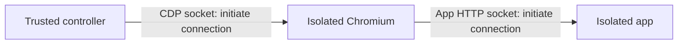

# Local Linux isolation proof

`SandboxSession` owns an isolated app, browser, and synthetic controller. Each uses a separate Linux network, PID, and mount namespace, UID 10000, no capabilities, `no-new-privileges`, a read-only root filesystem, bounded tmpfs, and explicit CPU/memory/process limits. It accepts a trusted immutable local image ID and fixed mounts; repository configuration cannot add Docker options or mounts.

Docker's [`none` network](https://docs.docker.com/engine/network/drivers/none/) disconnects containers from external networks. The proof additionally checks addresses, routes, capabilities, namespace IDs, and actual denied requests. LinuxKit creates inactive tunnel interfaces in these namespaces; the gate rejects configured non-loopback interfaces or routes, rather than interpreting inactive device names as network access.

Two named volumes carry Unix sockets. Each socket directory has one writable mount; clients mount it read-only. Socket connections still carry requests and replies in both directions. No controller service socket or host filesystem is mounted into the app/browser.



The fixture uses a loopback TCP-to-Unix bridge so Chromium can load `http://localhost:4173/`. A separate Unix-to-loopback bridge exposes Chromium CDP to the controller. There are no host port publications, host networking/PID namespaces, host homes, Docker sockets, or credential mounts. App and controller volumes never overlap. The shared socket directories contain only synthetic app/CDP endpoints, never credentials.

The controller fixture creates fresh synthetic credential values in its process environment and private files and starts a private loopback HTTP listener. A controller diagnostic verifies those canaries and the listener exist. App and browser diagnostics then try `/proc`, filesystem paths, controller loopback, host gateways, metadata, public IPv4, and IPv6. Browser JavaScript additionally tries the TypeSafe, GitHub, GitHub media, and a candidate Cursor hostname, plus a redirect to the controller. The exact production Grok/provider destinations still require P04/P05 proof.

These are the [Docker runtime controls](https://docs.docker.com/engine/containers/run/) enforced by the fixture. Startup and diagnostic commands receive an explicit environment using `env -i`; that hygiene supplements namespaces and mounts. A small [Unix WebSocket client](https://websockets.readthedocs.io/en/15.0.1/reference/sync/client.html) in the synthetic fixture verifies controller-initiated CDP and app reachability. It is not a Jev adaptation or an action planner.

## Run the gate

Run on a trusted development host with a local Linux Docker daemon. The build context is only the fixture directory and its allowlisted files; no repository checkout, `.env` file, credential, or Docker socket is passed to the build/container. The base image digest and Python wheel hash are pinned. Apt package versions and the resulting immutable image ID are recorded in the evidence; apt repositories are not snapshot-pinned, so rebuilding can produce a different image ID.

```sh
uv sync --locked
docker build --tag pro-tour-isolation-probe:local containers/isolation-probe
PRO_TOUR_PROBE_IMAGE=$(docker image inspect pro-tour-isolation-probe:local --format '{{.Id}}')
uv run --locked python scripts/check_isolation.py \
  --image "$PRO_TOUR_PROBE_IMAGE" --output /tmp/pro-tour-isolation.json
```

The output path must be new. Success requires a usable Chromium app page, all forbidden requests denied, canaries visible only to the controller, separate namespaces, the declared resource restrictions, and cleanup verified by session labels. The gate also exercises a real timed-out container command and an injected Python cancellation with resource cleanup. It launches fresh app diagnostics for the install/build/start phase checks; actual PR lifecycle commands are not yet integrated.

Run the negative control separately. It deliberately requires an incorrect app response marker and must exit 1 with a failed report and verified cleanup:

```sh
uv run --locked python scripts/check_isolation.py \
  --image "$PRO_TOUR_PROBE_IMAGE" --output /tmp/pro-tour-isolation-negative.json \
  --negative-control
```

`SandboxSession` cleans up its own randomly named containers and volumes on normal exit, exceptions, and cancellation. It never prunes unrelated Docker resources. Incomplete cleanup raises an error and leaves resource names available for diagnosis. The Linux Docker engine itself is left running.

## Scope still requiring proof

This fixture is a local Linux arm64 Docker Desktop proof, not a GitHub Actions run. The controller currently also has `network=none`: positive controller-to-provider/upload access and role-specific destination allowlists are still unimplemented. No live credentials have entered these containers. Dependency download egress and its removal, safe PR source extraction, malicious archive/symlink probes, real install/build/start execution, configurable app port mapping, and production browser packaging are still pending.

Chromium is launched with `--no-sandbox` inside the restricted browser container for this fixture. The observed boundary is the container's process/filesystem/network restrictions; this does not establish a separate Chromium renderer sandbox. The production runner's browser/security profile still needs validation.

No Jev source was vendored or refactored, and the pristine upstream example has not run. This proof does not complete P03/P06/P24 or any video acceptance requirement. The next integrations must preserve the boundary while proving the pristine example and approved Grok/GitHub routes; environment clearing alone must never be presented as PR isolation.
